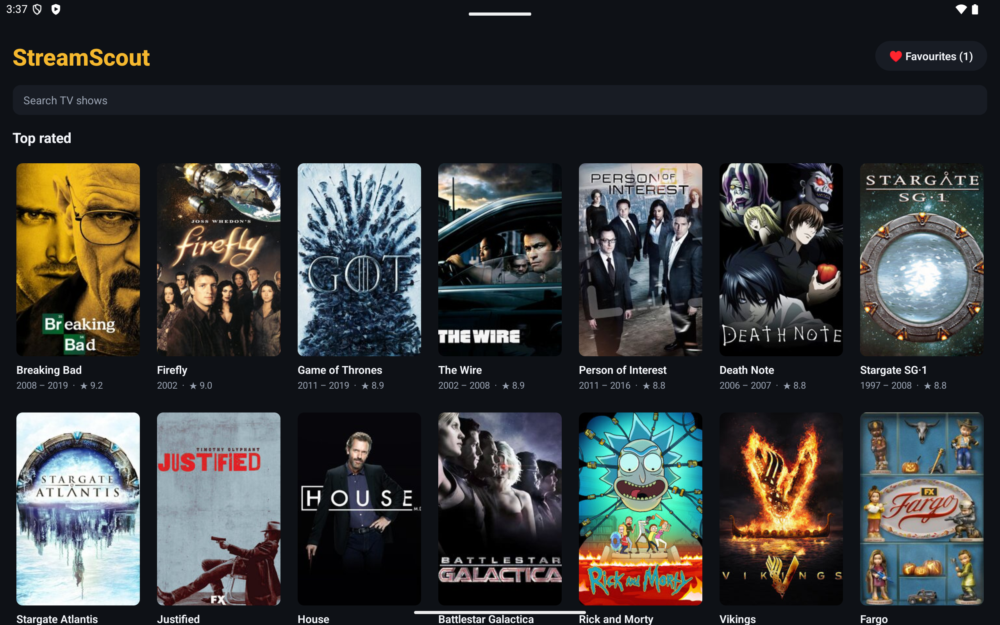
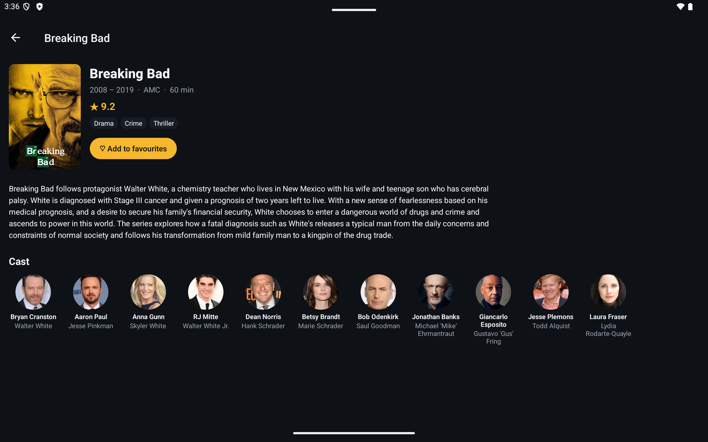

# StreamScout

A TV show browser built with React Native and TypeScript. The same codebase runs on **phones** (iOS and Android) and on **Android TV**, where it's controlled with a remote.

Data comes from the free [TVMaze API](https://www.tvmaze.com/api), so you can clone it and run it without any API key.

| Home | Show details |
|---|---|
|  |  |

<!-- TODO: add phone and Android TV screenshots -->

## What it does

- Shows the top-rated shows in a grid that adapts to the screen: 2 columns on a small phone, more on tablets and TVs
- Searches as you type, with debouncing so it doesn't fire a request on every keystroke
- Opens a details screen with the poster, rating, genres, summary and cast
- Lets you save favourites, which are stored on the device and still show without internet
- Handles loading, errors (including TVMaze's rate limit) and empty results, with a retry button

## Why the TV part matters

Building for TV is different from building for a phone:

- **No touch.** Everything is reached with the D-pad, so every card and button has a visible focus state (border and scale). Without it, the user has no idea where they are.
- **Initial focus.** Each screen picks what gets focus first (`hasTVPreferredFocus`). Otherwise Android picks something random, often an item you can't see.
- **Fewer focus stops.** The cast list wraps instead of scrolling sideways. A horizontal list on TV needs every item to be focusable just to scroll it, which means more button presses for nothing.
- **Bigger sizes.** Text and spacing are scaled up 1.5x on TV, because people watch from a couch, not 30 cm away.
- **No header.** The remote has a back button, so the navigation header is hidden on TV to give the content more room.

The project uses [react-native-tvos](https://github.com/react-native-tvos/react-native-tvos), the community fork of React Native with TV support, in place of `react-native`.

## Tech stack

| | |
|---|---|
| Framework | React Native 0.83 (react-native-tvos), New Architecture |
| Language | TypeScript (strict) |
| Navigation | React Navigation 7 (native stack) |
| Server state | TanStack React Query 5: caching, retries, request cancellation |
| Client state | Zustand with persist middleware + AsyncStorage |
| Tests | Jest |

## Project structure

```
src/
  api/          TVMaze client and types
  components/   ShowCard, ShowGrid, FocusButton, CastList, state views
  hooks/        React Query hooks, useDebouncedValue
  navigation/   Stack navigator and route types
  screens/      Home, Details, Favorites
  store/        Favourites store (Zustand)
  utils/        Text helpers (HTML to plain text, year ranges)
  theme.ts      Colours, spacing, font sizes (scaled for TV)
__tests__/      Unit tests
```

A few decisions worth mentioning:

- **Server state and client state are separate.** API data lives in React Query, which handles caching and refetching. Favourites are real app state, so they live in Zustand. Putting API responses in a global store usually means rewriting caching by hand.
- **Favourites keep a small snapshot**, not the whole show object, so storage stays small and the favourites screen works offline.
- **Requests are cancelled** when you leave a screen or keep typing, using the `AbortSignal` React Query passes in.
- **The grid layout is a pure function** (`getGridLayout`), so it can be unit-tested without rendering anything.

## Running it

Requirements: Node 20+, JDK 17, Android Studio (for Android) and Xcode (for iOS).

```sh
npm install

# Android phone or Android TV emulator
npm run android

# iOS
cd ios && bundle install && bundle exec pod install && cd ..
npm run ios
```

To try the TV version, create an **Android TV** device in Android Studio's Device Manager (under the TV category), start it, then run `npm run android`.

## Checks

```sh
npx tsc --noEmit   # types
npm run lint       # ESLint
npm test           # Jest
```

## Possible next steps

- Episode list per season
- Infinite scroll through the whole TVMaze index
- Apple TV (tvOS) target, which react-native-tvos already supports
- Component tests with React Native Testing Library

## Credits

Show data and images are from [TVMaze](https://www.tvmaze.com), used under their [CC BY-SA licence](https://www.tvmaze.com/api#licensing).
